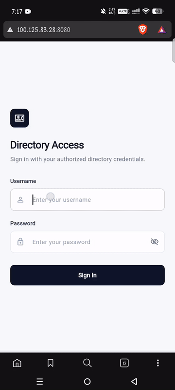

# Navigation Bar - Contact Directory

A Flutter application featuring a persistent bottom navigation bar for browsing contacts, favorites, and user profile management.

## Preview



Download the full video demo: [lyle.mp4](lyle.mp4)

## Features

- Persistent bottom navigation bar
- Contact directory list and profile details
- Favorites management
- User authentication and profile view

## Getting Started

1. Ensure Flutter is installed on your system.
2. Clone the repository:
   ```bash
   git clone https://github.com/lylleleonelviray/Navigation-Bar.git
   ```
3. Install dependencies:
   ```bash
   flutter pub get
   ```
4. Run the app:
   ```bash
   flutter run
   ```
